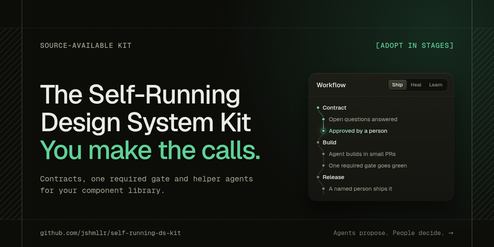
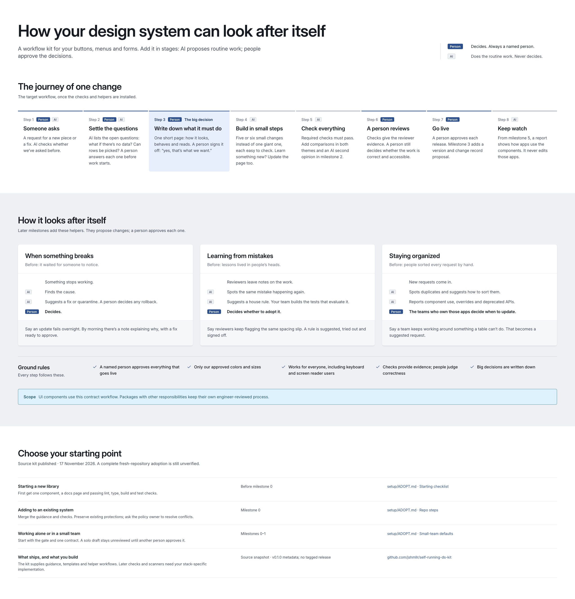
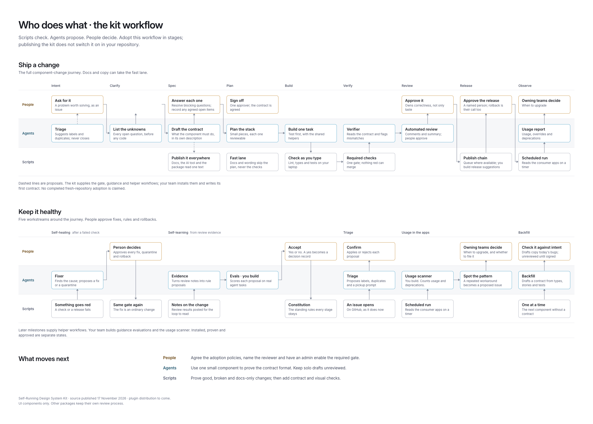

# The Self-Running Design System Kit



A packaged way of running a component library so that **an agreed contract drives every change, checks that can block a merge run where everyone sees them, agents do the routine work, and a named person makes every decision that matters.** 

People decide, helpers suggest.

The kit ships as a folder you copy from. Claude Code plugin: to come.

It provides the workflow around a coded component library: guidance, component contracts,
checks and proposed fixes. Designers and design managers can use it to define the process;
an engineer or coding agent and a repository admin are needed to wire up the checks.

An agentic, executable design system, not a design system in a box. Open your coding agent
with the adoption prompt; the agent should follow
[`skills/adopt/SKILL.md`](skills/adopt/SKILL.md) and propose a PR, not merge.

[](https://claude.ai/code/new?q=Adopt%20the%20Self-Running%20Design%20System%20Kit%20into%20this%20repo%20by%20following%20skills%2Fadopt%2FSKILL.md%20from%20https%3A%2F%2Fgithub.com%2Fjshmllr%2Fself-running-ds-kit.%20Propose%20changes%20as%20a%20PR%3B%20do%20not%20merge.)
[](https://cursor.com/link/prompt?text=Adopt%20the%20Self-Running%20Design%20System%20Kit%20into%20this%20repo%20by%20following%20skills%2Fadopt%2FSKILL.md%20from%20https%3A%2F%2Fgithub.com%2Fjshmllr%2Fself-running-ds-kit.%20Propose%20changes%20as%20a%20PR%3B%20do%20not%20merge.)
[](https://chatgpt.com/codex)

The Codex button opens Codex only; it does not prefill the prompt. In the Codex
desktop app, paste this link to prefill it:

```text
codex://new?prompt=Adopt%20the%20Self-Running%20Design%20System%20Kit%20into%20this%20repo%20by%20following%20skills%2Fadopt%2FSKILL.md%20from%20https%3A%2F%2Fgithub.com%2Fjshmllr%2Fself-running-ds-kit.%20Propose%20changes%20as%20a%20PR%3B%20do%20not%20merge.
```

## Tl;Dr

Right now, when someone changes a building block (a button, a menu, a form field) a lot of good checking happens, but it is optional: a change can go out with problems, and when something breaks it waits for a person to notice. 

This kit changes the order. Before a piece is built, its promise is written down and a person agrees to it. 

Then helpers build in small pieces, check against the promise, diagnose their own mistakes and propose fixes, learn from review feedback, and keep the to-do list tidy. 

People stay in charge of what to build, whether it's correct, what ships, what rolls back, and what the rules are.

## Choose your starting point

- **New library:** first establish a small working library with a component, tests, a docs
  surface and working lint, typecheck, build and test commands. A framework starter is a
  starting point; it may still need tests, documentation and package output added. Use the
  [starting checklist](setup/ADOPT.md#starting-checklist) before installing this kit.
- **Existing design system:** keep your components, tokens, docs and release process.
  Inventory your current checks and policies, then merge the kit into them one milestone
  at a time. The [adoption guide](setup/ADOPT.md#3-repo-steps-contributor-prs) explains conflicts
  and preserving existing files.
- **Solo or small team:** milestones 0–1 are a useful first adoption target: a real gate,
  shared guidance and one component contract. Later automation can wait. See
  [the personal-account route](#trying-it-on-a-personal-account) and the
  [small-team defaults](setup/ADOPT.md#small-team-defaults-and-later-settings).

## See the workflow

The full workflow is a target to adopt in stages. These visuals distinguish the work
people approve from the work agents propose, and show which later pieces your team builds.

[](docs/images/kit-workflow-overview.png)

### Who does what: people, agents and scripts

[](docs/images/kit-workflow-roles.png)

## The six milestones

| Milestone | Name | What it gives you | In the kit | You build |
| --- | --- | --- | --- | --- |
| 0 | Make the gate real | One required check, a merge queue, a fast lane for docs and copy, a shared agent toolkit | Everything | Nothing |
| 1 | Agree the contract | One contract format per component, proven on a real component, with written rules and a review checklist | Everything | Your first contract |
| 2 | Stronger verify | A contract check, a visual check in both themes, a second-opinion review | The review agent, the gate wiring | The contract checker, the visual check |
| 3 | Self-healing | A diagnosis and proposed fix when the main branch goes red; a suggested release size and change record | The fix proposal agent | The release suggestion |
| 4 | Self-learning | A guidance check, a weekly evidence digest, guidance evals, backfill drafts for old components | The guidance check, the evidence digest, the backfill agent | The guidance evals |
| 5 | Self-managing | Triage proposals; a read-only usage report from consumer apps | The triage agent, the usage report workflow | The usage scanner |

Early release: the fresh-repository proof run has not been done yet;
[`setup/proof-run.md`](setup/proof-run.md) is that test.

**The "You build" pieces are part of the plan, not extras:** a
milestone is not done until they exist. Each one reads your own code, so it has to be
written for your stack; the milestone doc says exactly what it must do, who decides, and
gives a ready-to-paste prompt to build it. None needs a paid service or an enterprise plan.

Start at [`docs/milestones/0-gate.md`](docs/milestones/0-gate.md).

## What's in the box

```
README.md                      ← this file: the roadmap for anyone
docs/
  architecture.md              ← the map (Mermaid is the source; drawings copy it)
  file-inventory.md            ← every file by bucket: core / local / adapter
  gotchas.md                   ← 44 things learned the hard way
  adapters.md                  ← what another stack or host swaps
  milestones/0-gate.md … 5-self-managing.md
  proposals/rule-tiers.md      ← Floor / Reflex / Finish tiers for rules (not adopted)
templates/                     ← files that go into your repository, with {{PLACEHOLDERS}}
  CLAUDE.md, AGENTS.md
  docs/automation-map.md       ← what runs, when, and where a person decides: for approvers
  .github/  workflows/pr-gate.yml + six helper workflows (contract review, fix proposal,
            triage, backfill, evidence digest, usage report) · templates/ ·
            rulesets/*.json · CODEOWNERS · labels.json · pull_request_template.md ·
            copilot-instructions.md · instructions/
  tooling/  guidance/ (guidance check) · evidence/ (evidence digest) · README.md
  .claude/  settings.json · hooks/load-planning-skill.js · commands/validate.md ·
            skills/product-design/ (skill shape, gaps file, decision template, exemplars)
  .prettierignore
skills/                        ← the shared toolkit (this is what the plugin installs)
  adopt · contract-review · review-triage ·
  grilling · tdd · diagnosing-bugs · codebase-design · writing-for-agents (vendored, MIT)
adapters/react-storybook/      ← React 19 + Storybook + GitHub + Claude Code: first adapter
setup/ADOPT.md                 ← decisions, placeholders, repo steps, admin steps, proofs
setup/proof-run.md             ← the fresh-repo test: does it work without us?
scripts/fill-placeholders.sh
THIRD-PARTY-NOTICES.md
.gitignore
LICENSE                        ← PolyForm Shield 1.0.0 for Josh's own files
.claude-plugin/plugin.json
```

## Getting started

### Workflow requirements

Have these before the first step. The kit itself has no build and nothing to install from a package registry; your library must pass the [starting checklist](setup/ADOPT.md#starting-checklist) first.

| Need                                   | Why                                                                                  | Without it                                   |
| -------------------------------------- | ------------------------------------------------------------------------------------ | -------------------------------------------- |
| **Git** and a GitHub repository        | Every milestone is a PR; the gate, labels and rules are GitHub features               | Nothing in `templates/.github/` applies      |
| **Repository owned by an organisation** (for the queue) | The merge queue is only offered on organisation-owned repositories. Public repos get it free; private repos need a paid organisation plan | A personal account still gets the required check; follow `docs/milestones/0-gate.md` § Personal account |
| **Admin on that repository** (one person) | Rulesets, the merge queue, labels and bypasses are host settings                      | Checks run but never block a merge           |
| **GitHub Actions** enabled              | The gate is a workflow; the ruleset names it by its job name                          | No gate                                      |
| **Claude Code** (CLI, current release)  | Hosts the plugin, the skills, the planning hook and the `/validate` command           | Use the files as plain docs; skills are Markdown and read fine in any agent that loads `SKILL.md` files |
| **Node.js** your library supports; 22.18+ from milestone 4 | The planning hook and the milestone 4 tooling are Node scripts; the four commands your gate runs are your own | The planning hook never fires and the milestone 4 tooling cannot run |
| **`gh` CLI**, logged in                 | The `review-triage` skill and the admin runbook use it; the ruleset is posted with it  | Do the admin steps in the browser instead    |
| A POSIX shell with `sed`                | `scripts/fill-placeholders.sh`                                                        | Fill the `{{PLACEHOLDERS}}` by hand          |
| **A Claude credential** as a repository secret (milestones 2 to 5) | The helper agents run Claude Code inside GitHub Actions | Each agent step skips with a notice; the plain checks still run |


#### Optional: 
GitHub Copilot code review (the kit ships a `copilot-instructions.md`); the React + Storybook adapter if that is your stack.

The gate workflow runs on GitHub's `ubuntu-latest` runners, which already have `jq`; you do not need it locally.

### Install

**Available now: copy the files.** Follow the scratch-copy steps below, then ask your
coding agent to adopt the kit using the included `skills/adopt/SKILL.md` instructions.

**Claude Code plugin: to come.** Plugin scaffolding is included for future distribution.
The folder-based setup is the current documented route; an official marketplace release
has not been published.

```bash
git clone https://github.com/jshmllr/self-running-ds-kit.git
cd your-design-system
kit_stage=$(mktemp -d)
cp -R ../self-running-ds-kit/templates/. "$kit_stage/"
# trim "$kit_stage" to the milestone 0 files and write values.env, then:
sh ../self-running-ds-kit/scripts/fill-placeholders.sh values.env "$kit_stage" --milestone-0
```

This fills a scratch copy and leaves the kit untouched. Before filling, keep only the
milestone 0 files listed in [`setup/ADOPT.md`](setup/ADOPT.md) § 3, and write `values.env`
from § 2. Then merge the filled files into your repository, and copy `skills/*` and
`THIRD-PARTY-NOTICES.md` into `.claude/skills/`. Where a file already exists, § 3 says how
to merge.

### Day Zero

1. Read this file, then [`setup/ADOPT.md`](setup/ADOPT.md) § 1. Write down the eight decisions; they become the `Source:` lines of your rules.
2. Copy and merge the files using the steps above. Open the three milestone 0 PRs: toolkit, fast lane, gate.
3. Hand [`docs/milestones/0-gate.md`](docs/milestones/0-gate.md) § Admin steps to your admin. Nothing blocks a merge until they are done.
4. Run the gate's three proofs (green, red, skipped) and paste the run links into the gate PR.
5. Milestone 1: pick one small component, write its contract, open the contract PR, then the rules PR. At the end, run [`setup/proof-run.md`](setup/proof-run.md) once.
6. Milestones 2 to 5, one at a time: install the kit's pieces, then build the "You build" pieces with the prompts in each milestone doc. Fill in [`templates/docs/automation-map.md`](templates/docs/automation-map.md) as each piece goes live, and show it to whoever approves the automation.

### Trying it on a personal account

You do not need an organisation to try the kit; you lose only the merge queue. This is the
smallest adoption route, in a fresh repository under your own account. The time depends
on whether your library already passes the starting checklist.

1. **Make a public repository** (public, so rulesets are free) with a tiny component library
   in it: one component, one test, and a `package.json` with `lint`, `typecheck`, `build`
   and `test` scripts, plus a docs surface. Complete the starting checklist first; a
   framework starter alone may not provide these pieces.
2. **Copy the kit files** using the steps above, then ask your agent to "adopt the kit". Answer the decisions and
   placeholders; `ORG` is your username.
3. **Open the gate PR** with `.github/workflows/pr-gate.yml`. Merge it yourself once it is
   green; no rule exists yet, so nothing stops you.
4. **Import the ruleset** `templates/.github/rulesets/default-branch-gate-only.json` under
   Settings → Rules → Rulesets → Import, or post it with `gh api` as shown in
   [`docs/milestones/0-gate.md`](docs/milestones/0-gate.md) § Personal account. Create the
   `fast-lane` label.
5. **Prove the gate.** Open a PR with a deliberate type error: the gate goes red and the
   Merge button is disabled. Fix it: green, button enabled. Open a PR that touches only
   `README.md`: the path-gated jobs show `skipped`, the gate is green.
6. **Prove the fast lane.** Add the `fast-lane` label to that docs PR, tick the checkbox in
   the template. The planning stages are skipped; the gate still ran.
7. **Milestone 1.** Write the contract for your one component in its own docs source, open
   the contract PR, and ask one other person to approve it so the Status line can name
   them. Solo? Leave it `Draft, not reviewed`.

What you cannot test alone: the merge queue, and approvals, since GitHub will not let you
approve your own PR. Everything else in milestones 0 and 1 behaves exactly as it will in an
organisation. Moving to an organisation later means swapping the ruleset and adding
CODEOWNERS ([`0-gate.md`](docs/milestones/0-gate.md) § Personal account); the workflow
stays as it is.

### What to tell your team

- **Nothing merges without the gate**, and the gate is one check with one name. If a check is skipped, that is fine; if it fails, the gate fails.
- **Docs and copy changes take the fast lane**: label the PR according to your team's conventions, skip the planning, still get the check and the approval.
- **Every component change starts from its contract.** If the contract has to change, that is the first commit in the PR, and a person re-approves it.
- **Agents propose, people decide.** No bot merges, releases, rolls back or quarantines.

## Design rules the kit obeys

These came out of the origin's engineering review and shaped every later decision. Keep them when you extend the kit.

1. **Review does not shrink to "taste only".** Better checks make review shorter because the evidence is better; the reviewer still owns correctness. A verifier is a second opinion, never a substitute approval.
2. **Only UI components are in the contract loop.** Packages whose contract is semantics keep an engineer-reviewed, decision-record process. 
3. **A named person is in every merge, release, rollback and quarantine decision.** Automation suggests a version, drafts a fix, proposes a quarantine; it never acts on them. No automatic canary or rollback.
4. **The fast lane is docs and user-visible copy only.** Dependency bumps carry supply-chain risk and get full review. Version bumps never appear in feature PRs.
5. **A contract drafted from code describes today's behaviour, bugs included.** Backfill drafts are labelled unreviewed, and the signing engineer checks them against intent.

## Words / Vocabulary

- **Gate**: the one always-run required check. Path-gated jobs are skipped, not failed.
- **Fast lane**: skips the planning stages, never a check or the approval.
- **Contract**: what a component promises its consumers, in its own docs source. Also called a spec elsewhere.
- **Status line**: `Draft, not reviewed` or `Approved by <name> on <date>`.
- **Proof**: the one named test behind each promise. "Visual check only" for looks.
- **Part kinds**: named spot · set of parts · swap what it's drawn as · built in.
- **Toolkit**: the shared skills committed to the repo so every clone behaves the same.
- **Constitution**: AGENTS.md, CLAUDE.md and the product-design skill.

## Releases

No tagged GitHub release has been published yet. The plugin manifests currently identify
this source kit as `0.1.0`; that is not a published release or an official marketplace listing.

- **Unreleased:** README refinements, author links, and updated workflow visuals.
- **17 November 2026 — adoption updates:** clearer starting paths, safer setup checks,
  explicit CI setup and review ownership. [Commit and validation notes](https://github.com/jshmllr/self-running-ds-kit/commit/50db561).
- **17 November 2026 — initial kit:** the first public source snapshot.
  [Initial commit](https://github.com/jshmllr/self-running-ds-kit/commit/48b7442).

[Published releases](https://github.com/jshmllr/self-running-ds-kit/releases) ·
[Source history](https://github.com/jshmllr/self-running-ds-kit/commits/main/) ·
[Download current source](https://github.com/jshmllr/self-running-ds-kit/archive/refs/heads/main.zip).

The complete fresh-repository proof run is still unverified. Each adopting team must run
the milestone proofs against its own tools and branch rules.

## About Josh

Created and maintained by **Josh Miller**.

[Website](https://jshmllr.com) · [LinkedIn](https://www.linkedin.com/in/jshmllr) ·
[X](https://x.com/_jshmllr)

## Licence

The kit's own files (docs, templates, scripts, and the `adopt`, `contract-review` and
`review-triage` skills) are © 2026 [Josh Miller](https://github.com/jshmllr) and licensed
under [PolyForm Shield 1.0.0](LICENSE)
([canonical text](https://polyformproject.org/licenses/shield/1.0.0)).
PolyForm Shield 1.0.0 covers only Josh Miller's own files.

Vendored third-party skills from [mattpocock/skills](https://github.com/mattpocock/skills)
and [vercel-labs/agent-skills](https://github.com/vercel-labs/agent-skills) stay under their
authors' MIT licences. Notices for those skills stay in
[`THIRD-PARTY-NOTICES.md`](THIRD-PARTY-NOTICES.md).

Training, resale or bundling? [Contact me](https://github.com/jshmllr) for a commercial license.

"Self-Running Design System Kit" is Josh Miller's name for this project; forks and
derivatives must not use the name or imply endorsement.

## Before publishing this kit

- Run `claude plugin validate .` after any change to `.claude-plugin/`. `LICENSE` is the unmodified CC BY-SA 4.0 text so the host detects it; leave it as it is.
- Run the proof run once on a throwaway repository and fix every hole it finds.
- Milestones 2 to 5 each include pieces the adopting team builds. Say so wherever the kit is announced.
