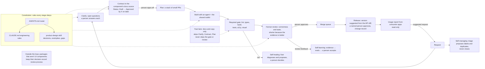

# Architecture: the self-running design system

This file is the **source** for every picture of the system. Drawn versions (slides,
whiteboards, design-tool boards) copy its structure and names; when they disagree, this
file wins, because it can be checked against the kit's files.

## The map

Read it as one sentence: **people decide, helpers suggest.** A named person signs off the
contract, approves the merge, approves the release and approves a rollback. The reviewer
still owns correctness. Automation collects evidence, runs the checks that can block, and
proposes.

## The four loops

| Loop              | Trigger                              | Automation does                                                        | A person does                           |
| ----------------- | ------------------------------------ | ---------------------------------------------------------------------- | --------------------------------------- |
| **Self-healing**  | A red required check or failed release | Diagnoses (failing command, suspect commit) and proposes a fix or a quarantine | Decides every fix and every quarantine  |
| **Self-learning** | Repeated review findings or waivers  | Collects evidence, proposes a rule change, scores it with evals        | Accepts or rejects the rule             |
| **Self-managing** | New issues; a weekly schedule        | Proposes duplicates and labels, adds a pickup prompt, posts a digest   | Confirms; nothing is closed by a helper |
| **Backfill**      | The first PR that touches an old component | Drafts its contract from the code, labelled unreviewed              | Checks the draft against intent, signs  |

## Where each step runs

For approvers, `templates/docs/automation-map.md` is the same picture as one table: every
automated piece, when it runs, what it reads and writes, and where a person decides.

Rule: **if it can block a merge, it runs on the host (GitHub)**, where everyone sees it and
nothing depends on one laptop. The local agent runs the same checks earlier, for fast
feedback.

| Stage          | Local agent session                                   | Host (GitHub)                                                               |
| -------------- | ----------------------------------------------------- | --------------------------------------------------------------------------- |
| Intent, triage | Writes issues by hand                                 | Triage job proposes labels and duplicates (milestone 5)                     |
| Clarify        | `grilling` skill; open questions as an issue checklist | The checklist blocks the contract until every box is ticked                |
| Contract       | Written in the component's docs source               | Reviewed as its own PR; one approval from `{{APPROVER_TEAM}}`               |
| Plan           | Plans in chat or `.claude/plans/`; output = small PRs | Stacked PRs                                                                 |
| Build          | Agent + toolkit; `/validate` before every push        | Nothing                                                                     |
| Verify         | `/validate` (advisory, early)                         | `{{VALIDATION_WORKFLOW}}` ending in the required `{{GATE_CHECK_NAME}}`; verifier posts findings as a second opinion (milestone 2) |
| Review         | `/code-review`, `/review-triage`; results posted on the PR | Automated review + posted findings; the reviewer approves and owns correctness |
| Release        | Nothing                                               | Merge queue; version suggested from the API diff; `{{RELEASE_APPROVER}}` approves; change record (milestone 3) |
| Fixer, observe | Nothing                                               | Scheduled jobs: fixer proposals, read-only usage report (milestones 3, 5)   |
| Evals          | Local eval skill                                      | Run on PRs that touch guidance files (milestone 4)                          |

Both the local agent and the host's review bot read the same constitution:
`.github/copilot-instructions.md` points at `AGENTS.md`, and the toolkit is committed so a
fresh clone behaves the same way.

## The constitution

Three documents, each with one job. Every rule has exactly one home.

| Document                               | Owns                                                                            |
| -------------------------------------- | ------------------------------------------------------------------------------- |
| `AGENTS.md`                            | Routing: which file answers which question; the hard stops; when to load skills |
| `CLAUDE.md`                            | How to build correctly: architecture, styling, a11y, testing, contract, fast lane, PR format, validation |
| `.claude/skills/product-design/`       | What to build and why: decisions with evidence, exemplars with known flaws, the honest list of gaps |

## What it feels like, in two stories

**A new component.** Someone asks for a Table. A helper suggests whether it's a duplicate
and which labels it needs; a person confirms. The assistant lists everything still
unclear (empty state, selection, sorting) and a person answers each one; nothing starts
while a question is open. The contract is written and a person says "yes, that's what we
want": the main decision point. The work is split into five or six small PRs. Each is
built with an assistant that already knows the house rules. Every check must pass before
anything goes in, including the picture comparison in both themes. A second reviewer, an
agent, notes where the work doesn't match the contract. The human review is shorter, not
smaller in responsibility. The release is suggested, then approved by a named person.
Later, a helper reads the consumer apps' code and reports how the Table is used.

**A bug in an existing component.** The first time anyone touches Dialog, a helper drafts
its contract from the code, bugs included. You treat it as unreviewed, add the bug's
correct behaviour as a promise ("focus returns to the button that opened it"), and a
person approves it. You fix the bug; the new promise names the test that proves it. Your
review notes appear on the PR. If the fix only changed wording, it takes the fast lane:
no plan, no sign-off, every check. If the same kind of bug keeps showing up, the system
proposes a house rule, evals test it, and a person decides.

## Scope line

The contract loop covers UI components under `{{COMPONENT_DIR}}`. Packages whose contract
is semantics rather than look and behaviour (`{{OUT_OF_LOOP_PACKAGES}}`) keep their
engineer-reviewed, decision-record process: contracts, visual diff, the verifier and
backfill do not apply to them, because a picture can't see a wrong null-handling rule.
